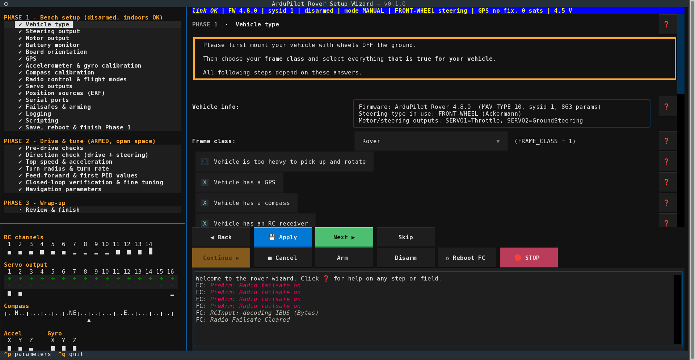
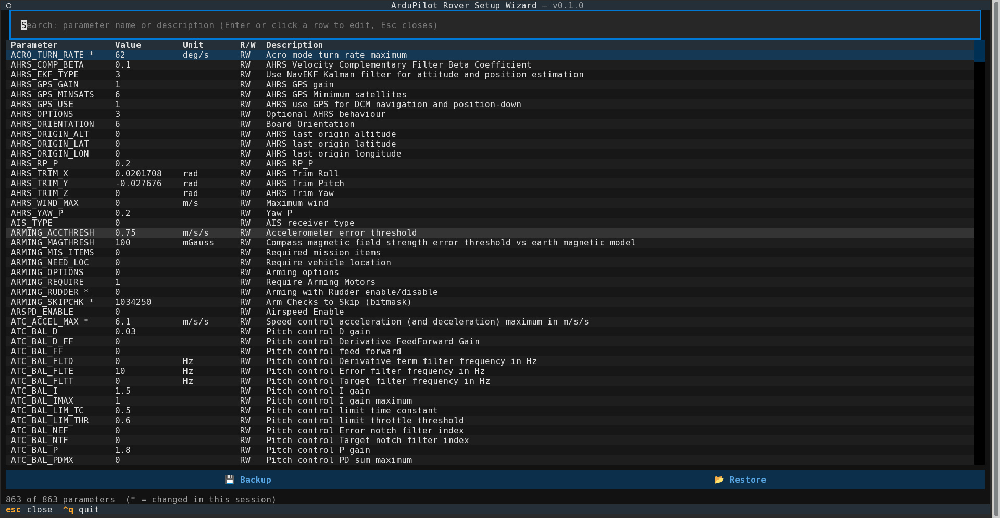

# ArduPilot Rover Setup & Tuning Wizard

[](https://github.com/heeplr/rover-wizard/actions/workflows/tests.yml)
[](https://github.com/heeplr/rover-wizard/tree/python-coverage-comment-action-data)




A Textual TUI wizard that talks MAVLink to an ArduPilot Rover (currently no boats) and walks through setup, calibration
and tuning step by step with the ability to autoprobe various settings.
Supports **front-wheel (Ackermann) steering** and **skid steering**.
Click "❓" next to any step or field for help.


## Features
* autoprobes various settings (e.g. MOT_THR_MIN, GPSx_TYPE, ATC_SPEED_MAX, TURN_RADIUS, PID parameters etc.)
* realtime monitor for RC-Channels, Servo outputs, Accel, Gyro, relay states
* adjust arbitrary servo's PWM to verify connections
* set/get parameters from commandline with wildcard support (e.g. `rover-wizard --param ATC_SPEED_*`)
* parameter view to list/edit all parameters
* extensive documentation built into app
* works with current vehicle settings or after factory reset
* backup/restore current FC parameter config
* show/undo parameter changes


## Install

Inside the project directory run:

```sh
python -m venv venv
. venv/bin/activate
pip install .
```

to use a venv or install systemwide with

```sh
pip install .
```

## Run
```sh
rover-wizard --help
usage: rover_wizard [-h] [--version] [--conn CONN] [--baud BAUD] [--demo] [--demo-skid] [-p NAME[=VALUE]]

ArduPilot Rover setup & tuning wizard (Textual UI)

options:
  -h, --help            show this help message and exit
  --version             show program's version number and exit
  --conn CONN           MAVLink connection string, e.g. /dev/ttyACM0, udpin:0.0.0.0:14550
  --baud BAUD           serial baud rate (ignored for UDP/TCP)
  --demo                use a simulated front-wheel-steering rover
  --demo-skid           use a simulated skid-steering rover
  -p, --param NAME[=VALUE]
                        print a parameter (NAME, or a pattern like 'SERVO1_*') or
                        write it (NAME=VALUE), then exit without the UI; repeatable, handled in order

rover-wizard --conn /dev/ttyACM0 --baud 115200
```

or, without installing:

```
pip install -r requirements.txt
python -m rover_wizard --conn /dev/ttyACM0 --baud 115200     # or COM5, udpin:0.0.0.0:14550, tcp:127.0.0.1:5760
python -m rover_wizard --demo            # simulated front-wheel rover, no hardware (try the UI)
python -m rover_wizard --demo-skid       # simulated skid-steer rover
```

If `--conn` (or `--demo`) is given, the wizard connects immediately; the connect screen only stays up if that
attempt fails. The connection auto-recovers if it drops (e.g. a TCP link resets) - the status bar shows
"reconnecting ..." until it's back.

`--param` or `-p` let's you read/write parameters from the commandline without TUI.


## Usage

### Setup phases
1. Bench setup - vehicle disarmed, can be done indoors
2. Drive & tune - vehicle armed, needs open space
3. Wrap-up - finalize setup

Every phase consists of several setup steps. Navigate them in the treeview or using the "Back", "Next", or "Skip" buttons.
Settings and measurements are stored in `~/.rover_wizard/vehicle_<sysid>.json`, so you can stop anytime and continue later.
Every step where the vehicle moves lets you choose **automatic** (wizard drives) or **manual** (you drive, wizard records).

### Optional Hardware
The first step has a checkbox for each piece of hardware ArduPilot Rover can do without.
Just check every hardware that is present on your rover.


### Automatic probes
Several settings have a **Probe** button for autoprobing.
Press to try autoconfiguration. The "❓" button displays a help text describing what will be done and what to take care for.


### Driving commander

In probes during Phase 2, you can choose to drive maneuvers yourself (**manual**) while
the wizard records or let the wizard command the vehicle (**automatic**).
See help for details.


### Live panel
Below the step list, there is a monitor section:
 * **RC channels** shows a bar for every channel your receiver delivers that is updated in realtime.
 * **Servo output** shows the state of each output. You can change it by pressing the +/- buttons.
 * **Compass** stripe compass shows current heading
 * **Accel** shows current accelerometer output
 * **Gyro** shows current gyroscope output
 * **Relais** shows current state for each relay if present (click to switch)


### Parameter screen
Pressing <kbd>Ctrl</kbd> + <kbd>p</kbd> (or clicking `^p parameters` in the bottom menu) will open a complete, searchable list of parameters:





* Double click a row to edit the parameter.
* Press `Backup` to save all parameters to a file.
* Press `Restore` to restore parameters from a file.
* Press <kbd>Esc</kbd> to exit the parameter screen.


## Tests
```
pip install .[test] pymavlink textual      # pytest plus the libraries the tests exercise
pytest                                     # from the project folder
```
The tests run without hardware: a physics simulator stands in for the vehicle, a small fake autopilot built on
pymavlink checks what the wizard actually sends over MAVLink (UDP on localhost), and the real Textual UI is driven
headless with Textual's test pilot. Set `ROVER_WIZARD_SCREENSHOTS` to a folder to keep a text screenshot of every step.


## Disclaimer
This is a vibecoding experiment designed & created by an LLM model using carefully written prompts ("You sure can hydrate a pizza, mom!").
Most of the code was read by a human and all changes (human or AI) are recorded in the git history.
There's a [checklist](HUMAN_CHECKS.md) that lists, which functions haven't been tested by a human, yet.
Please feel free to contribute if you tested something (un)successfully.
The checklist will be removed when everything has been successfully tested once.


# **WARNING!**
This software configures a vehicle that can move on its own: test every setting with the wheels off the ground
or in a safe, enclosed, obstacle fee, flat area and keep your transmitter and the STOP button at hand.
Review what the wizard changed before relying on it. It has been verified with a simulator, automated tests,
and on real hardware but there *can* and *will* be bugs.
Please take extra care to prevent harm in the case your vehicle acts erratic.

